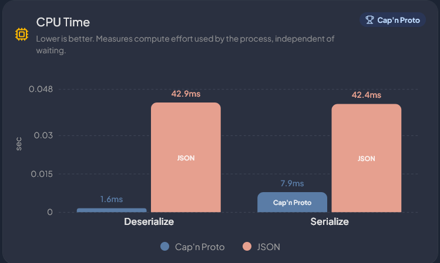

# Zero-Copy Binary API Gateway

[](https://zerocopy.mariakevin.in/)
[](https://capnproto.org/)
[](https://fastapi.tiangolo.com/)
[](https://react.dev/)
[](#)

> Fast binary serialization vs JSON — live charts, real benchmarks, zero fluff.

**Live demo:** [https://zerocopy.mariakevin.in/](https://zerocopy.mariakevin.in/)



---

## The problem

Most APIs still move data as **JSON**.

That works, but at scale it costs you:

- Extra CPU to encode and decode text
- Larger payloads over the wire
- Slower serialize / deserialize loops

When you process thousands or millions of records, those costs add up fast.

---

## The solution

Use a **binary format** instead of text.

This project uses **[Cap'n Proto](https://capnproto.org/)** — a fast binary serialization format with a zero-copy style design — and compares it live against JSON on the same workload.

You pick a schema and record count. The app runs both formats and shows:

- **CPU time** (lower is better)
- **Throughput** (higher is better)

So you can *see* the difference, not just read about it.

---

## Demo

Try it here: **[zerocopy.mariakevin.in](https://zerocopy.mariakevin.in/)**

1. Choose how many records
2. Hit **Run Simulation**
3. Watch Cap'n Proto vs JSON update live


---

## Benefits

| Benefit | Why it matters |
| --- | --- |
| **Less CPU** | Binary packing avoids heavy text parsing |
| **Higher throughput** | More records processed per second |
| **Live comparison** | Side-by-side charts, not theory |
| **Scalable tests** | Run from 10K to very large record counts |
| **Clear UX** | Winner badges + simple metric explanations |

---

## Tech stack

- **Cap'n Proto** — binary serialization (core idea)
- **C++** — native benchmark engine
- **FastAPI** — WebSocket API + progress streaming
- **React + Vite + Recharts** — live dashboard

---

## How it works

```text
Browser dashboard
      │  WebSocket
      ▼
FastAPI backend
      │  runs binary
      ▼
C++ Cap'n Proto vs JSON benchmark
      │  progress + results
      ▼
Live charts (CPU + throughput)
```

---

## Quick start (Docker)

```bash
docker build -t zero-copy .
docker run --rm -p 8000:8000 zero-copy
```

Open [http://localhost:8000](http://localhost:8000)

---

## Local development

### Backend

```bash
cd backend
pip install -r requirements.txt
# set BENCHMARK_EXE to your built binary if needed
uvicorn app:app --reload --host 0.0.0.0 --port 8000
```

### Frontend

```bash
cd frontend
npm install
npm run dev
```

Frontend proxies `/api` and `/ws` to the backend in development.

### Build the C++ benchmark

```bash
cmake -S cpp -B cpp/build -DCMAKE_BUILD_TYPE=Release
cmake --build cpp/build --config Release
```

Point the backend at the binary with `BENCHMARK_EXE` if needed.

---

## Project layout

```text
backend/     FastAPI + WebSocket API
frontend/    React dashboard
cpp/         Cap'n Proto vs JSON benchmark
assets/      Screenshots / media
Dockerfile   Multi-stage production image
```

---

## Why Cap'n Proto

Cap'n Proto stores data in a compact binary layout. For many serialize/deserialize workloads, that means:

- less CPU than JSON text encode/decode
- smaller messages
- better throughput under load

This repo makes that comparison interactive.

---

## Links

- **Live demo:** [https://zerocopy.mariakevin.in/](https://zerocopy.mariakevin.in/)
- **Repo:** [https://github.com/kevinnadar22/zero-copy](https://github.com/kevinnadar22/zero-copy)
- **Cap'n Proto:** [https://capnproto.org/](https://capnproto.org/)
